# Biomarker Explorer

Find genes that track how cancer cell lines respond to a drug, using public DepMap and GDSC2 data.



The picture above is the Venetoclax case study: blocking BCL-2 lets the cell's death signal through, and the cell breaks apart. In the app that drawing plays as a short animation. On GitHub it stays still.

Pick a drug and the app lists genes whose expression goes with a better response or a worse one. Pick a gene and it lists the drugs that gene is linked to. Blue means higher expression went with a better response. Pink means a worse one. A lower AUC means the drug reduced survival more, so a sensitivity link is a negative correlation.

The first example is Venetoclax and BCL2. BCL2 is the strongest sensitivity gene for that drug (r = −0.30 across 698 cell lines). The case-study page walks through why that result is expected, and what it does not prove.

## Run it on your computer

The tables the app reads are already in `processed/`, so you do not need the raw DepMap files to start.

```bash
cd drug-sensitivity-ai
python3 -m venv .venv
source .venv/bin/activate
pip install -r requirements.txt
streamlit run app/main.py
```

Then open http://localhost:8501. Leave that terminal running. To stop the app, press Control-C in the terminal.

On Windows, turn the environment on with `.venv\Scripts\activate` instead of `source`.

## Pages

- **Home.** What the colours mean, and where to start.
- **Search by drug.** The 50 strongest sensitivity genes and the 50 strongest resistance genes, plus a volcano plot.
- **Search by gene.** Which drugs include that gene in a top-50 list. A useful second example is SLFN11.
- **Explore.** Expression against drug response for one drug and one gene, coloured by cancer type.
- **Case study: Venetoclax.** A written read of the BCL2 result.
- **About & limitations.** Where the numbers come from, and what a correlation does not prove.

## Data

Expression is DepMap RNA sequencing, log2(TPM + 1), one default profile per cell line. Drug response is GDSC2 AUC. The screen keeps the 708 cell lines present in both, then tests 286 drugs. For each drug it saves the 50 genes most linked to sensitivity and the 50 most linked to resistance, with a Spearman correlation and a false discovery rate.

The raw files stay out of git. The expression file alone is about 377 MB, and `data/` is listed in `.gitignore`. The app reads the smaller tables in `processed/` (about 43 MB).

To rebuild those tables, put these files in `data/` and run `python scripts/build_database.py` from the project folder:

- `OmicsExpressionTPMLogp1HumanProteinCodingGenes.csv`
- `Model.csv`
- `GDSC2AUCMatrix.csv`
- `GDSC2Log2ViabilityConditions.csv`

## Deploy

This app is set up for [Streamlit Community Cloud](https://streamlit.io/cloud). Point it at a GitHub repo with this folder as the root, and set the main file to `app/main.py`. `requirements.txt` is pinned, and `processed/` has to be in the repo so the deployed app has its tables. Python 3.12 is what this copy was built with.

## A limit worth knowing

These are cancer cell lines grown in a dish, not patients. A gene can track drug response without being the reason the drug works. The About page says this more carefully.
